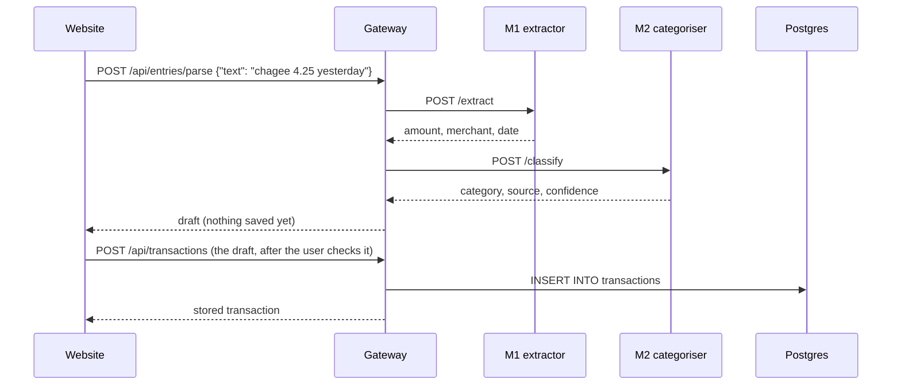

# Spendcheck integration contracts

**Status: implemented.** Drafted by Okaggar (Modules 4 and 5) at the start so all five modules
could be built in parallel and merged without surprises; this file now records the interfaces as
built (31 Oct 2026). Changes go through a pull request that everyone sees.

## 1. Repository layout (one repo for the whole group)

```
spendcheck/
├── docker-compose.yml        local stack: every service + Postgres
├── .env.example              copy to .env for compose
├── db/init/                  shared schema (runs once on an empty database)
├── libs/common/              shared helpers: middleware, X-User-Id, LLM client
├── services/
│   ├── gateway/              public API for the website           (owner: Okaggar Bo)
│   ├── extractor/            Module 1  NLP entity extraction     (owner: Pham Ngoc Minh)
│   ├── categoriser/          Module 2  merchant categoriser      (owner: Xuanxi Yang)
│   ├── forecaster/           Module 3  spending forecaster       (owner: Muhaimin Ihsan)
│   ├── chat-agent/           Module 4  budget chat agent         (owner: Okaggar Bo)
│   └── report-reader/        Module 5  SGX report reader         (owner: Okaggar Bo)
├── frontend/                 website: React + Vite, served by nginx (owner: Okaggar Bo)
├── data/reports/             report manifests (the PDFs are downloaded, not committed)
├── scripts/                  refresh_demo.sh (demo data, copied to the VM)
├── k8s/                      Kubernetes manifests (kubectl apply -k k8s/)
└── docs/                     this file, the Module 4 and 5 design, changes made to team code
```

Each service folder contains `Dockerfile`, `requirements.txt`, `app/` (FastAPI code), `tests/`,
optionally `eval/` (its evaluation scripts) and a `README.md`.

## 2. Rules the services follow

1. **Python + FastAPI**, one container per module, listening on **port 8000** inside the
   container (the website's nginx listens on 80).
2. **`GET /health`** on every service: the process is alive, no dependency checks. Modules 4 and 5
   also have **`GET /ready`** (the database is reachable). Kubernetes probes call these.
3. Endpoints take and return JSON defined with Pydantic models; errors use normal HTTP status codes
   with FastAPI's `{"detail": "..."}` body. Modules 4 and 5 put their endpoints under `/v1/`;
   Modules 1 to 3 kept their own paths (`/extract`, `/classify`, `/forecast`).
4. **User identity comes from the `X-User-Id` header**, set only by the gateway. Services never
   read a user ID from the request body.
5. The gateway creates an **`X-Request-ID`** (or keeps the one nginx sends) and forwards it on
   every call to a module. Modules 4 and 5 install the shared middleware, which passes it on and
   adds **`X-Process-Time-Ms`**; the gateway returns a `Server-Timing` header with the time spent
   in each module:
   ```python
   from spendcheck_common import install_common_middleware
   install_common_middleware(app, service_name="chat-agent")
   ```
6. **Configuration only through environment variables.** No secrets in images or in git (`.env`
   and `k8s/secrets.env` are git-ignored).
7. **Build context:** Modules 4 and 5 build from the repo root, so `libs/common` is in the build
   context (`docker build -f services/chat-agent/Dockerfile .`); the other services build from their
   own folder. `docker-compose.yml` has the exact context for each. Package versions are pinned.
8. The **compose service name = Kubernetes Service name = hostname** other services use.

## 3. Service map

| Module | Service | Compose host port | In-cluster URL | Endpoints |
|---|---|---|---|---|
| Gateway | `gateway` | 8000 | `http://gateway:8000` | public `/api/*` (section 5) |
| 1 | `extractor` | 8001 | `http://extractor:8000` | `POST /extract` |
| 2 | `categoriser` | 8002 | `http://categoriser:8000` | `POST /classify` |
| 3 | `forecaster` | 8003 | `http://forecaster:8000` | `POST /forecast` |
| 4 | `chat-agent` | 8004 | `http://chat-agent:8000` | `POST /v1/chat` |
| 5 | `report-reader` | 8005 | `http://report-reader:8000` | `POST /v1/ask`, `GET /v1/documents` |
| DB | `postgres` | 5432 | `postgres:5432` | Postgres 16 + pgvector |
| UI | `frontend` | 3000 | `http://frontend:80` (the Ingress sends `/` here) | website; nginx forwards `/api` to the gateway |

## 4. Endpoint contracts

### Module 1: `POST /extract` (team code in `services/extractor`)
```json
// request
{"text": "spent $8.90 at Kopitiam yesterday", "reference_datetime": "2026-10-06T18:30:00+08:00"}
// response
{"amount": 8.9, "merchant": "Kopitiam", "date": "2026-10-05", "status": "ok", "missing_fields": []}
```
`reference_datetime` must include a timezone offset; it resolves "yesterday" and makes results
repeatable. Fields it cannot extract confidently are `null`, with `status: "incomplete"` and the
names in `missing_fields`, so the UI can ask the user to fill them in. Model failures return 503.

### Module 2: `POST /classify` (team code in `services/categoriser`)
```json
// request: only the merchant; extra fields are rejected
{"merchant": "NTUC FairPrice"}
// response
{"category": "Groceries", "confidence": null, "source": "lookup", "model_version": "merchant-categoriser-v1"}
```
`source` is `lookup` (exact catalogue match, `confidence: null`) or `model` (MiniLM fallback,
uncalibrated probability). Nine categories: Food & Drink, Groceries, Transport, Shopping,
Entertainment, Bills & Utilities, Health, Education, Other. The database adds Travel for manual
entries. A bare "Grab" or "Apple" returns **422 ambiguous_merchant**; the gateway retries "<name>
ride" when the entry mentions a destination, otherwise the user picks the category.

### Module 3: `POST /forecast` (team code in `services/forecaster`)
```json
// request: the caller sends the user's transactions (Module 3 is stateless and has no DB access)
{"transactions": [{"date": "2026-09-03", "amount": 320, "merchant": "Chagee", "category": "Food & Drink"}],
 "as_of": "2026-10-14", "budget": 900, "method": "ml"}
// response
{"as_of": "2026-10-14", "month": "2026-10", "method": "ml", "spent_so_far": 180.0,
 "forecast_total": 327.96, "days_elapsed": 14, "days_in_month": 31, "months_of_history": 3,
 "one_off_spend": 0.0,
 "risk": {"alert": false, "reference": 355.67, "source": "usual_level",
          "reason": "forecast 327.96 is within usual_level 355.67"}}
```
`as_of`, `budget` and `method` are optional (`method` defaults to the trained `ml` model). With a
budget the alert compares the forecast with it, otherwise with 1.1 x the 3-month average. Callers
(Module 4's `get_forecast` tool, the gateway) read the user's transactions and budget themselves.
`one_off_spend` was added during integration (`docs/team-changes/`).

### Module 4: `POST /v1/chat` (header `X-User-Id`)
```json
// request ("persona" is optional and changes the wording only, never the numbers)
{"message": "Can I afford a $300 concert ticket?",
 "history": [{"role": "user", "content": "..."}, {"role": "assistant", "content": "..."}],
 "mode": "agent",
 "persona": {"name": "Bo", "tone": "chill"}}
// response
{"answer": "You have spent $412 of your $800 October budget ...",
 "mode": "agent",
 "steps": [{"tool": "run_sql", "input": {"query": "SELECT ..."}, "output_preview": "[{\"sum\": 412.3}]", "is_error": false},
           {"tool": "get_forecast", "input": {}, "output_preview": "{...}", "is_error": false}],
 "citations": [],
 "model": "nvidia/nemotron-3-super-120b-a12b:free"}
```
**One assistant for everything.** Module 4 is the single chat the user talks to. Questions about
the user's spending are answered from the database and Module 3; questions about a company are
passed to Module 5 (`search_annual_reports` tool), and its page citations come back in `citations`
(same fields as Module 5's citations). So the website has **one chat page**, not two.

The service is stateless: the website sends the recent `history`. `steps` lets the UI show how an
answer was computed. `mode: "baseline"` exists for the evaluation only. A `429` reply means the
free model's limit (20 per minute, 50 per day) was reached, and the website says so.

### Module 5: `POST /v1/ask` and `GET /v1/documents`
```json
// POST /v1/ask request (company / fiscal_year / doc_id / top_k are optional)
{"question": "What was DBS's net profit in 2025?", "company": "DBS Group Holdings Ltd", "fiscal_year": 2025, "mode": "full"}
// response
{"answer": "DBS reported a net profit of ...",
 "mode": "full",
 "citations": [{"doc_id": "sgx/D05/2025", "company": "DBS Group Holdings Ltd", "fiscal_year": 2025,
                "page": 89, "quote": "..."}],
 "retrieved": [{"doc_id": "sgx/D05/2025", "page": 89, "chunk_type": "page", "score": 0.031}],
 "model": "nvidia/nemotron-3-super-120b-a12b:free",
 "disclaimer": "Factual information from company reports only. Not investment advice."}
// GET /v1/documents response
[{"doc_id": "sgx/D05/2025", "corpus": "sgx", "company": "DBS Group Holdings Ltd", "ticker": "D05",
  "fiscal_year": 2025, "n_pages": 107}]
```
Annual reports are public, so Module 5 does not need `X-User-Id`. Its main caller is Module 4; the
website uses `/v1/documents` (through the gateway) to list the companies. Loaded: 3 SGX annual
reports, 20 FinanceBench filings and a 5-page sample report (24 documents).

## 5. Gateway (`services/gateway`, host port 8000)

The gateway is the only service the website talks to. It acts as `DEMO_USER_ID` (no login in the
demo), sets `X-User-Id` and `X-Request-ID` for the modules, and returns a `Server-Timing` header
with the time spent in each module (e.g. `extractor;dur=7.2, categoriser;dur=4.0, total;dur=12.7`).

| Public route | What it does |
|---|---|
| `GET /api/status` | which modules and the database are up |
| `GET /api/categories` | category names |
| `POST /api/entries/parse` `{"text": "..."}` | Module 1 then Module 2 -> a **draft** (nothing saved): amount, merchant, date (today if not mentioned), category, `missing_fields`, `needs_review`, plain-English `notes` |
| `POST /api/transactions` | save a confirmed draft |
| `GET /api/transactions?month=YYYY-MM&limit=` | newest first |
| `DELETE /api/transactions/{id}` | remove one |
| `GET /api/summary?month=YYYY-MM` | spent, overall budget, totals by category (with category budgets) and by day |
| `GET /api/forecast` | Module 3 on the user's transactions and this month's budget |
| `GET /api/budgets?month=` / `PUT /api/budgets` / `DELETE /api/budgets?month=&category=` | read / set / remove budgets (overall or per category) |
| `POST /api/chat` `{"message", "history", "persona"}` | Module 4 (which calls Modules 3 and 5 itself); 429 and 503 pass through |
| `GET /api/reports/documents` | Module 5's ingested reports |



Keeping the database write in the gateway, after the user has checked the draft, means a wrong
guess never reaches the database, and Modules 1 and 2 stay stateless and can be tested and scaled
on their own.

## 6. Shared database

Schema: `db/init/002_schema.sql`. Roles: `db/init/001_roles.sh`.

| Table | Written by | Read by | DB role |
|---|---|---|---|
| `users`, `transactions`, `budgets` | gateway (and the seed script) | gateway | `spendcheck_app` |
| `transactions`, `budgets`, `categories` (one user's rows only) | (none) | Module 4 | `chat_agent_ro` |
| `reports.documents`, `reports.chunks` | Module 5 ingest job | Module 5 | `report_reader` |

Module 4's role can only SELECT, and row-level security limits it to the user in `X-User-Id`.
Init scripts run only on an empty database. After a schema change, recreate the local database
with `docker compose down -v && docker compose up` (this deletes local data).

## 7. Decisions made

1. Categories: Module 2's nine, plus Travel for manual entries.
2. Request and response shapes: as in section 4.
3. Gateway and website: built by Okaggar during integration.
4. Hosting: the group's Ronin VM (AWS EC2 t3.medium, 2 vCPU, 4 GiB) running k3s, with the images
   in Amazon ECR and the annual reports in Amazon S3 (AWS Academy Learner Lab). See `k8s/README.md`.
5. GitHub repo with one branch per piece of work and pull requests into `main`.
6. The demo uses a fixed synthetic `demo-user` and no login.

## 8. Checklist before a module is merged into `main`

- [ ] Its Docker image builds with the context in `docker-compose.yml`
- [ ] `/health` responds (and `/ready` if it uses the database)
- [ ] Service added to `docker-compose.yml` and `k8s/` (Deployment + Service, added to `kustomization.yaml`)
- [ ] Endpoints match section 4 (or this file is updated in the same pull request)
- [ ] `README.md` in the service folder: purpose, environment variables, how to run its tests and evaluation
- [ ] No secrets, `.env` files or large data files committed
