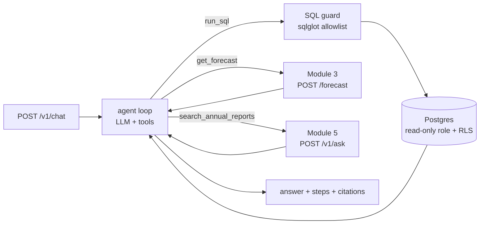
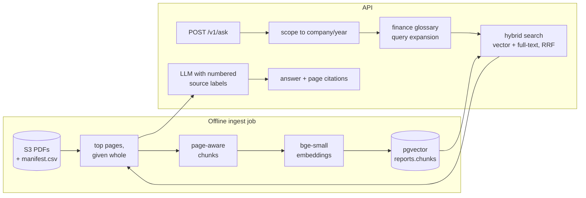

# Modules 4 and 5: design

Owner: Okaggar. This is the design of the two services; the shared rules are in `CONTRACTS.md`
and the evaluations in each service's `eval/README.md`.

## Module 4: Budget Chat Agent (`services/chat-agent`)

Proposal pipeline: user question -> LLM agent -> tool call (SQL query on transaction database or
forecast API) -> result -> plain-English answer.

**Module 4 is the one assistant the user talks to.** Company questions are handed to Module 5
through a tool, so budgeting and investing questions work in the same conversation (proposal,
novelty point 4) while the two modules stay separate services with separate evaluations.

**Status: implemented and deployed.** 35 unit tests pass (14 SQL guard, 10 agent loop with a fake
LLM, 9 LLM adapters with fake HTTP responses, 2 forecast tool); synthetic users seeded. Needs a
free OpenRouter key (`.env`) to answer.

| File | Role |
|---|---|
| `app/main.py` | FastAPI routes, startup (DB pool, LLM client), clear 503 if the LLM is not configured |
| `app/agent.py` | the tool-calling loop (max 6 steps); records every tool call and report citation |
| `app/tools/sql_tool.py` | `run_sql`: sqlglot allowlist (one SELECT, allowed tables, no `set_config` etc.), runs read-only |
| `app/tools/forecast_tool.py` | `get_forecast`: HTTP call to Module 3 |
| `app/tools/reports_tool.py` | `search_annual_reports`: HTTP call to Module 5, passes citations through |
| `app/tools/__init__.py` | tool list and dispatcher; failures become error results the LLM can recover from |
| `app/db.py` | connection pool; `user_scoped_readonly` sets the user for row-level security |
| `app/prompts.py` | system prompt with the schema (prompt-cached), the "today is" line and the persona's voice |
| `app/baseline.py` | evaluation baseline: same LLM, history pasted as CSV, no tools |
| `eval/seed_synthetic_user.py` | fixed-seed `eval-user` (1 Apr to 13 Oct 2026) and `demo-user` (last 6 months) |
| `eval/run_eval.py` | gold answers from `gold_sql`, calls both modes, scores, writes `results.csv` |
| `tests/` | unit tests, run in Docker: `docker compose run --rm --no-deps chat-eval python -m unittest discover -s tests -v` |

**Safety of LLM-written SQL (four layers).** sqlglot only lets through one SELECT on
`transactions`, `budgets`, `categories`; the database login (`chat_agent_ro`) has SELECT grants
only; each query runs in a READ ONLY transaction with a 3-second timeout; and Postgres row-level
security hides every row that is not the current user's. The last layer is enforced by the
database, so it holds even if the first three fail.

## Module 5: SGX Report Reader (`services/report-reader`)

Proposal pipeline: annual report PDF -> text and table extraction -> chunking + embeddings ->
vector database -> retrieve relevant pages -> LLM answer with page citations.

**Status: implemented and deployed.** 31 unit tests pass (7 ingest: PDF parsing on a generated
sample report and chunking; 18 retrieval and answers: scoping, rank fusion, citations with a fake
LLM; 6 evaluation scoring). Loaded: 3 SGX annual reports (DBS, Singapore Airlines, Sheng Siong),
20 FinanceBench filings and the sample report, 24 documents in all; the PDFs are kept in Amazon S3.

| File | Role |
|---|---|
| `ingest/run.py` | CLI and Kubernetes Job: manifest -> fetch (S3 or local) -> parse -> chunk -> embed -> store |
| `ingest/pdf_parse.py` | per-page text and Markdown tables (PyMuPDF); strips running headers, footers, page numbers |
| `ingest/chunking.py` | chunks never cross pages; tables are their own chunks (split by rows, header repeated) |
| `app/embeddings.py` | local `BAAI/bge-small-en-v1.5` via fastembed, baked into the image |
| `app/store.py` | pgvector similarity search (HNSW, iterative scan when scoped) and OR-ed full-text search |
| `app/glossary.py` | finance glossary: adds statement wording to analyst terms before searching |
| `app/retriever.py` | `basic` (dense top-k) and `full` (scope by company/year + hybrid + RRF) retrieval |
| `app/answer.py` | numbered source labels -> page citations, and the supporting sentence as the quote |
| `eval/make_sample_report.py` | generates a 5-page sample report with known facts, for tests and demos |
| `eval/` | FinanceBench subset (74 questions), SGX questions, `run_eval.py` (grading) and the results |

**Why the citations are verifiable.** In full mode the retrieved chunks are labelled [S1], [S2], ...
and the model must tag each fact with a label. Our code, not the model, maps the label to a chunk,
and every chunk belongs to exactly one page, so a citation can only point at a page whose text the
model was actually given. The quote shown is the sentence in that chunk sharing most words (and
especially numbers) with the answer. Basic mode instead asks the model to type "[p. N]" itself;
citation accuracy compares the two. This works with any LLM, including free ones.

## Design decisions (for report Section 3)

| Decision | Choice | Reason | Alternative considered |
|---|---|---|---|
| LLM | Free open models through OpenRouter: `LLM_MODEL` lists Nemotron 3 Super, then Nemotron 3 Ultra and Gemma 4 31B as fallbacks | zero cost (the group has no LLM budget); one key for many models; a model outage does not stop the chat | Claude via its API or Amazon Bedrock: same code, `LLM_PROVIDER=anthropic` or `bedrock` |
| Provider-neutral LLM layer | one `chat()` / `tool_results()` interface, adapters for OpenRouter (OpenAI format) and Claude | the agent never depends on a vendor; models can be compared in the report | calling one vendor's SDK directly |
| Free-tier limits | 20 requests/min, 50/day: evaluation paces itself and resumes across days | stays free | buying credit (1,000/day after US$10) |
| Agent loop | hand-written loop | records each tool call for the UI and the report; step limit | SDK tool runner |
| SQL safety | sqlglot allowlist + read-only role + READ ONLY transaction + row-level security | defence in depth | fixed query tools only (less flexible) |
| Vector store | pgvector in the shared Postgres | one database to operate; hybrid search in SQL; ingest is one transaction | Qdrant or Chroma container |
| Embeddings | bge-small-en-v1.5, local, CPU | free, offline, reproducible; baked into the image | Amazon Titan Text Embeddings |
| PDF parsing | PyMuPDF text + `find_tables` | page numbers preserved; tables as Markdown | pdfplumber; Amazon Textract (paid) |
| Ingestion | Kubernetes Job from a suspended CronJob | heavy batch work kept off the serving pods | ingest on API start-up |
| Citations | numbered source labels resolved by our code | provider-neutral; the model cannot invent a page | Claude's built-in citations (Claude only); model-typed "[p. N]" (the baseline) |
| Query expansion | finance glossary maps analyst terms to statement wording | took the first 5 FinanceBench questions from 0/5 to about 4.5/5 together with the next row | LLM query rewriting (costs a request per question) |
| Context unit | whole pages (top 6) built from the best chunks | tables and lists are never cut in half; citations are per page anyway | top-k chunks only (the baseline) |

## Evaluation (maps to the proposal's Evaluation Plan)

| Module | Data | Our system | Baseline | Metrics |
|---|---|---|---|---|
| 4 | synthetic user, 50 questions with gold SQL | `mode=agent` | `mode=baseline` (pasted CSV, no tools) | accuracy; latency |
| 5 | FinanceBench subset (74 questions) + SGX questions | `mode=full` | `mode=basic` (same LLM, dense top-k) | answer accuracy, evidence page retrieved (recall@k), citation accuracy, latency |
| System | Ronin VM deployment | per-container `X-Process-Time-Ms`, the gateway's `Server-Timing`, end-to-end time | | single timed runs |

OpenRouter's free models allow only 50 requests a day, so the full sets (about 250 requests for
each module) were not run. What was run, with the same model for both modes in each run:

| Module | Questions | Ours | Baseline | Details |
|---|---|---|---|---|
| 4 | 15 (q01 to q05 on 15 Oct, q06 to q15 on 27 Oct) | 15/15 correct | 11/15 | `services/chat-agent/eval/README.md` |
| 5 | 8 held-out FinanceBench questions (27 Oct) | 7/8 correct, evidence page 6/8 | 3/8, evidence page 2/8 | `services/report-reader/eval/README.md` |
| 5 | 3 SGX questions, answers checked by hand against the PDFs | 3/3 | | `sgx_questions.jsonl` |
